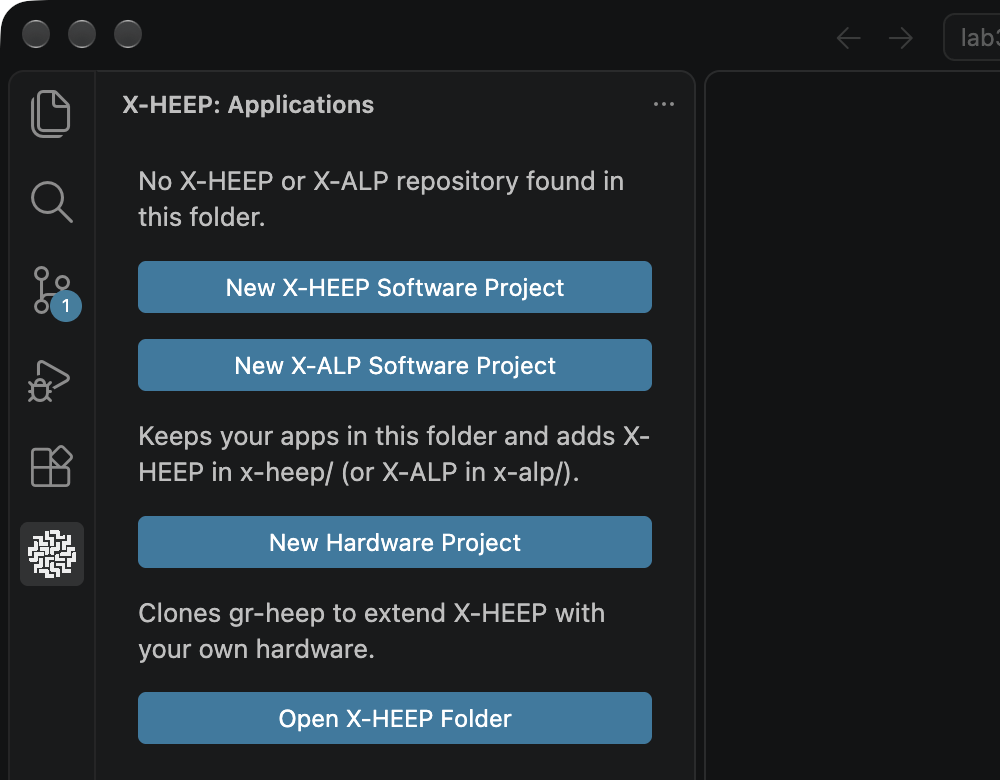
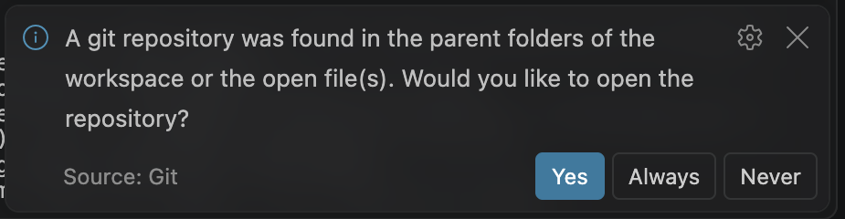
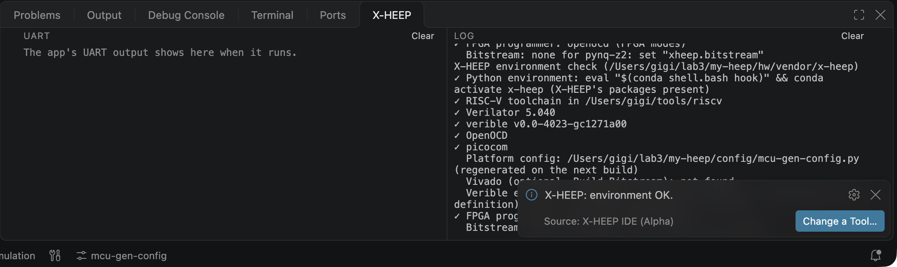
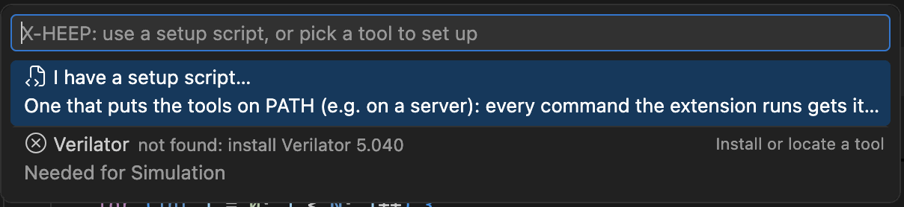

# Lab 3 — Integrate the accelerator into X-HEEP

MSc lab, groups of 3. Last of four activities.

| | | |
|---|---|---|
| Lab 0 | profile the applications, pick the kernel, justify it with Amdahl | done |
| Lab 1 | build that kernel as a standalone accelerator: model, RTL, testbench, synthesis, layout, power | done |
| Lab 2 | optimise it — retiming, pipelining, folding, arithmetic — and compare PPA against Lab 1 | done |
| **Lab 3** | integrate it into X-HEEP over OBI+REG, write the C driver, measure the real speedup | *this repository* |

This repository holds only a kit. You work in VS Code with the **X-HEEP IDE**
extension: it creates your X-HEEP project, checks your tools, and builds, runs
and debugs your applications; the kit adds the Lab 0 applications, the
testbench and the implementation flow to that project.

Supported hosts: **Linux**, **macOS**, **Windows + WSL2 (Ubuntu)**. You need
the tools from Lab 0 ([Lab 0 SETUP.md](https://github.com/Integrated-Systems-Architecture/ISA-LAB0/blob/main/SETUP.md))
on the machine you work on. If some are missing, step 3 helps you install them.

## 1. Install VS Code and the extension

**Linux and macOS**

1. Install [VS Code](https://code.visualstudio.com/).
2. Open the Extensions view (`Ctrl+Shift+X`, macOS `⇧⌘X`), search
   **X-HEEP IDE** (publisher `luigigiuffrida98`) and click **Install**.
   Or, from a terminal:

   ```bash
   code --install-extension luigigiuffrida98.x-heep-ide-alpha
   ```

   It also installs Microsoft's C/C++ extension, which it needs.

**Windows (WSL2)**

Everything runs inside WSL; VS Code on Windows is only the window.

1. Install [VS Code](https://code.visualstudio.com/) on Windows, and its
   **WSL** extension (`ms-vscode-remote.remote-wsl`).
2. Open the Ubuntu terminal, go to the folder where you keep your repositories
   (in the Linux home `~`, **not** under `/mnt/c`: builds there are 5–10× slower)
   and run `code .`. VS Code opens with **WSL: Ubuntu** in the bottom-left corner.
3. In the Extensions view, search **X-HEEP IDE** and click **Install in WSL: Ubuntu**.
   Or, from the Ubuntu terminal:

   ```bash
   code --install-extension luigigiuffrida98.x-heep-ide-alpha
   ```

## 2. Create your hardware project

1. Clone this repository and open it in VS Code (`code <repository>`; on
   Windows, from the Ubuntu terminal).
2. Click the X-HEEP icon in the activity bar, then **New Hardware Project**.

   

3. Pick this repository as the folder and click **Create Project Here**.
4. Give the project a name: lowercase letters and digits, words separated by
   `-` or `_` (here `my-heep`).

   

   The extension clones [gr-heep](https://github.com/x-heep/gr-heep) (X-HEEP
   plus room for your own hardware) into `<name>/`, renames it
   (`hw/<name>/<name>.sv`, core `x-heep:systems:<name>`) and opens that folder.
   **From now on, open `<name>/` in VS Code**, not the repository root: the
   extension works only there.

5. Install the kit, from the repository root (the folder that contains `<name>/`):

   ```bash
   python3 kit/install.py <name>
   ```

   It adds the applications, the testbench and the implementation scripts to
   your project, sets the memory to 128 KiB (32 KiB code, 96 KiB data) and
   keeps the outputs of the ASIC tools out of git (`.gitignore`).

6. The extension makes `<name>/` a git repository of its own. Your project
   belongs in this repository: delete the inner one and commit.

   ```bash
   rm -rf <name>/.git              # the inner repository only
   git add <name>
   git commit -m "Add <name>, from gr-heep, with the Lab 3 kit"
   git push
   ```

   It is about 190 MB, X-HEEP included. GitHub warns about one large file
   (a `.lib` of about 80 MB): ignore the warning.

7. VS Code then asks about the git repository in the parent folder: click
   **Always**, so the Source Control view shows this repository.

   

## 3. Check the environment

When the project opens, the extension checks the Python environment, the
RISC-V toolchain, Verilator and verible. Run **X-HEEP: Check Environment**
from the Command Palette (`Ctrl+Shift+P`, macOS `⇧⌘P`) to see the result. The
**X-HEEP** tab in the bottom panel lists each tool. You are done when it says
**environment OK**:



When something is missing, a notification says so:


**Show Details** lists each problem. **Fix…** walks you through them, one tool
at a time:



| Tool | What to pick |
|------|--------------|
| Python environment | your Lab 0 conda environment `x-heep`, under *Found on this computer*. No conda environment at all: **Install…** |
| RISC-V toolchain | the Lab 0 one, if listed, or **Locate…** its folder (`~/tools/riscv`). Otherwise **Install…** |
| Verilator | **Install…**: it builds 5.040 from source, several minutes. It needs the OS packages of Lab 0 SETUP.md §1 |
| verible | **Install…** on Linux and WSL. **macOS: do not use Install…** (it downloads the Linux build): follow Lab 0 SETUP.md §5, then **Locate…** `verible-verilog-format` |

Then run **X-HEEP: Check Environment** again, until it says **environment OK**.

## 4. Import your accelerator

From here on, the example is the CORDIC of
[ISA-LAB1-EXAMPLE](https://github.com/Integrated-Systems-Architecture/ISA-LAB1-EXAMPLE),
integrated in a project called `my-heep`. Every snippet is working code: do
the same with your names.

Your accelerator stays in your Lab 2 repository; the project imports a tagged
version of it with X-HEEP's vendor tool. Start from `lab2-delivery`; when you fix
something, fix it in the Lab 2 repository, tag it, and import again.

**Describe it** in `hw/vendor/cordic_accel.vendor.hjson`:

```hjson
{
  name: "cordic_accel"
  target_dir: "cordic_accel"

  upstream: {
    url: "https://github.com/Integrated-Systems-Architecture/ISA-LAB1-EXAMPLE.git"
    rev: "main"
  }

  exclude_from_upstream: [
    ".gitignore"
    "*.md"
    "Makefile"
    "build"
    "figures"
    "implementation"
    "model"
    "sw"
    "tb"
    "util"
    "vectors"
    "vendor"
  ]
}
```

For yours: your repository (`git@github.com:Integrated-Systems-Architecture/<your-lab2-repo>.git`)
and your tag as `rev`. Only `rtl/`, `data/` and `accel.core` must come through:
`vendor/` in particular holds IP cores X-HEEP already has.

**Import it**: set `ACCEL ?= cordic_accel` at the top of `lab3.mk`, then

```bash
make accel
```

It copies the tagged files into `hw/vendor/cordic_accel/` and generates the
register files your Lab 2 repository does not commit: `rtl/*_reg_{pkg,top}.sv`
from `data/*.hjson`, and the C header in `sw/external/lib/drivers/cordic_accel/`.

**Use it** from `my-heep.core`, fileset `files_rtl_generic`:

```yaml
    depend:
    - x-heep::packages
    ...
    - isa:lab1:cordic_accel
    files:
    - hw/my-heep/cordic_accel_xheep.sv
    - hw/my-heep/my_heep_pkg.sv
    ...
```

`isa:lab1:<accel>` is the name in your `accel.core`; `cordic_accel_xheep.sv` is
the wrapper of the next section.

X-HEEP builds with `-Wall` and stops at the first warning. Waive the warnings of
your RTL in `hw/my-heep/cordic_accel.vlt`, listed in the `files_verilator_waiver`
fileset of `my-heep.core`:

```
`verilator_config

lint_off -rule TIMESCALEMOD
lint_off -rule SYNCASYNCNET
lint_off -file "*/hw/vendor/cordic_accel/*"
lint_off -file "*/common_cells/src/credit_counter.sv"
```

The first two come from the `timescale` in your RTL and from a reset used both
synchronously and asynchronously; the last line is for an IP only the CORDIC
uses. Add lines for what your build reports.

**SRAMs.** Your `sram_wrapper` instances now use X-HEEP's `sram_wrapper` (same
ports, plus three power-gating pins you can leave unconnected). It has no
`BeWidth` parameter: drop it from your instances. Delete any copy of
`sram_wrapper` you keep in `rtl/`. A two-port memory (one write port, one read
port) is `sram_wrapper_2p`, provided by the kit for simulation, FPGA and SG13G2.

## 5. Connect it to X-HEEP

Your accelerator has two ports (Lab 1): the CSRs on the register interface,
the data on OBI. X-HEEP has a slot for each: an **external peripheral** for the
CSRs, an **external master** on the system bus for the data.

**Declare them** in `config/mcu-gen-config.py`, in `my_heep_config()`:

```python
    ext_xbar_nmasters = 1

    ext_periph = {
        "cordic_accel": {
            "offset": 0x00000000,
            "length": 0x00001000,
        },
    }
```

**Adapt the ports.** X-HEEP's OBI has no `a`/`r` channels and no transaction
id. Its register interface has the same fields as yours in another order, so
you pass its types to your accelerator as parameters. One wrapper does both,
`hw/my-heep/cordic_accel_xheep.sv`:

```systemverilog
module cordic_accel_xheep
  import cordic_accel_types_pkg::*;
(
  input  logic                          clk_i,
  input  logic                          rst_ni,
  input  xheep_reg_pkg::xheep_reg_req_t reg_req_i,
  output xheep_reg_pkg::xheep_reg_rsp_t reg_rsp_o,
  output xheep_obi_pkg::xheep_obi_req_t obi_req_o,
  input  xheep_obi_pkg::xheep_obi_rsp_t obi_rsp_i
);

  cordic_obi_req_t req;
  cordic_obi_rsp_t rsp;
  logic [IdWidth-1:0] rid;
  logic full;

  cordic_accel #(
    .reg_req_t(xheep_reg_pkg::xheep_reg_req_t),
    .reg_rsp_t(xheep_reg_pkg::xheep_reg_rsp_t)
  ) i_accel (
    .clk_i,
    .rst_ni,
    .testmode_i(1'b0),
    .reg_req_i,
    .reg_rsp_o,
    .obi_req_o(req),
    .obi_rsp_i(rsp)
  );

  // X-HEEP's OBI has no transaction id: responses come back in order, so keep the ids in a FIFO.
  fifo_v3 #(
    .DATA_WIDTH(IdWidth),
    .DEPTH     (4)
  ) i_rid_fifo (
    .clk_i,
    .rst_ni,
    .flush_i   (1'b0),
    .testmode_i(1'b0),
    .full_o    (full),
    .empty_o   (),
    .usage_o   (),
    .data_i    (req.a.aid),
    .push_i    (obi_req_o.req & obi_rsp_i.gnt),
    .data_o    (rid),
    .pop_i     (obi_rsp_i.rvalid)
  );

  assign obi_req_o.req   = req.req & ~full;
  assign obi_req_o.we    = req.a.we;
  assign obi_req_o.be    = req.a.be;
  assign obi_req_o.addr  = req.a.addr;
  assign obi_req_o.wdata = req.a.wdata;

  assign rsp.gnt          = obi_rsp_i.gnt & ~full;
  assign rsp.rvalid       = obi_rsp_i.rvalid;
  assign rsp.r.rdata      = obi_rsp_i.rdata;
  assign rsp.r.rid        = rid;
  assign rsp.r.err        = 1'b0;
  assign rsp.r.r_optional = '0;

endmodule
```

For yours: your module, your types package, your OBI struct names. Keep the
id FIFO even if your accelerator ignores `rid`.

**Instantiate it** in `hw/my-heep/my_heep_peripherals.sv.tpl`, below
`// Instantiate here the external peripherals`:

```systemverilog
    cordic_accel_xheep cordic_accel_i (
        .clk_i,
        .rst_ni,
        .reg_req_i(my_heep_peripheral_req[my_heep_pkg::CordicAccelPeriphIdx]),
        .reg_rsp_o(my_heep_peripheral_rsp[my_heep_pkg::CordicAccelPeriphIdx]),
        .obi_req_o(my_heep_master_req_o[0]),
        .obi_rsp_i(my_heep_master_resp_i[0])
    );
```

Edit the `.tpl`, never the `.sv` next to it: `make mcu-gen` writes the `.sv`
from the `.tpl`. `CordicAccelPeriphIdx` comes from the name in `ext_periph`.

Now click Run on any app: the extension sees the new configuration and RTL,
regenerates the platform and rebuilds the simulation model. The accelerator's
CSRs are at `CORDIC_ACCEL_PERIPH_START_ADDRESS` (`0x20070000`), defined in the
generated `sw/external/lib/runtime/my_heep.h`; its data port sees the same
memory as the CPU, so a C pointer is the address it reads or writes.

## 6. Registers and driver

The application calls one function; only the driver touches the registers.

**The function** has the arguments of the kernel it replaces, in `kernels.h`:
the CORDIC driver provides `cordic_accel_sincos(theta, n, cos_out, sin_out)`,
like `k_cordic_sincos`.

**The registers.** Each argument is a register: a pointer is an address
(`SRC`, `DST`), a count is `N`, a scalar is a field. Then `CTRL.START` and
`STATUS.DONE`. An argument without a register means your register map is
missing one: add it in your Lab 2 repository (add, do not change the existing
ones), tag, and `make accel` again.

**The data format.** When the accelerator's memory format is not the kernel's,
the driver converts. The CORDIC reads one angle per 32-bit word and writes one
`{y, x}` pair per word; the application uses `int16_t` arrays. The conversion
runs on the CPU and counts in your speedup.

`sw/external/lib/drivers/cordic_accel/cordic_accel.h`:

```c
#ifndef CORDIC_ACCEL_H
#define CORDIC_ACCEL_H

#include <stdint.h>

// Rotates the seed by theta[i] (Q2.13), for n angles. xy[i] = {y[15:0], x[15:0]}, Q1.14.
void cordic_accel_rot(const int32_t *theta, uint32_t *xy, uint32_t n);

// Same arguments as k_cordic_sincos.
void cordic_accel_sincos(const int16_t *theta, int n, int16_t *cos_out, int16_t *sin_out);

#endif
```

`cordic_accel.c`:

```c
#include "cordic_accel.h"
#include "cordic_accel_regs.h"
#include "my_heep.h"

#define REG(offset) (*(volatile uint32_t *)(CORDIC_ACCEL_PERIPH_START_ADDRESS + (offset)))
#define CHUNK 256

static uint32_t buf[CHUNK];

void cordic_accel_rot(const int32_t *theta, uint32_t *xy, uint32_t n) {
    REG(CORDIC_ACCEL_SRC_REG_OFFSET) = (uint32_t)theta;
    REG(CORDIC_ACCEL_DST_REG_OFFSET) = (uint32_t)xy;
    REG(CORDIC_ACCEL_N_REG_OFFSET)   = n;
    REG(CORDIC_ACCEL_CTRL_REG_OFFSET) = 1u << CORDIC_ACCEL_CTRL_START_BIT;
    while (!(REG(CORDIC_ACCEL_STATUS_REG_OFFSET) & (1u << CORDIC_ACCEL_STATUS_DONE_BIT)))
        ;
}

// The accelerator reads one angle per 32-bit word and writes {y, x} in the same word.
void cordic_accel_sincos(const int16_t *theta, int n, int16_t *cos_out, int16_t *sin_out) {
    for (int base = 0; base < n; base += CHUNK) {
        int m = n - base < CHUNK ? n - base : CHUNK;
        for (int i = 0; i < m; i++)
            buf[i] = (uint32_t)(int32_t)theta[base + i];
        cordic_accel_rot((const int32_t *)buf, buf, (uint32_t)m);
        for (int i = 0; i < m; i++) {
            cos_out[base + i] = (int16_t)buf[i];
            sin_out[base + i] = (int16_t)(buf[i] >> 16);
        }
    }
}
```

Everything under `sw/external/` is compiled with every application: nothing
to register.

## 7. The applications

`sw/applications/` has the four Lab 0 applications. Each has a `config.h`,
the only file you edit:

```c
// SMALL for simulation, LARGE for the FPGA.
#define SIZE SMALL

// RUN_ALL: the whole application, checked against its golden checksum.
// Otherwise the calls to run alone, on synthetic data, OR-ed together:
//   regions  R_NCO R_MIXER R_FIR R_DECIMATE R_MAGNITUDE R_DETECT
//   calls    C_NCO C_MIX_I C_MIX_Q C_FIR_I C_FIR_Q C_DEC_I C_DEC_Q C_MAG C_DETECT
#define RUN R_NCO

// 1: the kernels mapped below run on your accelerator.
#define USE_ACCEL 1

#if USE_ACCEL
#include "cordic_accel.h"
#define k_cordic_sincos cordic_accel_sincos
#endif
```

- **SIZE.** `SMALL` are the Lab 0 sizes, for simulation. `LARGE` are the real
  ones (4096 samples, 28×28 MNIST images, a tiny vision transformer, 1024-point
  polynomials): run them on the FPGA.
- **RUN.** `RUN_ALL` runs the whole application and prints `PASS` or `FAIL`
  against its golden checksum. A region (`R_*`, the names of the profile table)
  or single calls (`C_*`) run alone, on synthetic data, and print a checksum:
  the same with `USE_ACCEL` 0 and 1 means your accelerator is right. Much
  faster in simulation, and it is the window the power analysis looks at.
- **USE_ACCEL.** The `#define` maps the kernel to your driver: every call to
  `k_cordic_sincos` becomes `cordic_accel_sincos`, `main.c` stays untouched.

The CORDIC, `rxchain`, `SIZE SMALL`, Verilator:

| run | `nco` cycles | `total` cycles | check |
|---|---|---|---|
| `RUN_ALL`, software | 91183 | 268680 | `PASS` |
| `RUN_ALL`, accelerator | 8532 | 186420 | `PASS` |
| `R_NCO`, software | 92673 | 92841 | `checksum=0x1db188cd` |
| `R_NCO`, accelerator | 8785 | 8957 | `checksum=0x1db188cd` |

The kernel's speedup is its cycles in software over its cycles on the
accelerator; the application's is the same ratio on `total`.

## 8. Simulate, and take the VCD you need

**Verilator** is what the extension's Run uses: the fastest, for every app and
every change.

**Questa** (ISA server) runs the same testbench as the gate-level simulations
of section 10, and writes VCD files:

```bash
make questasim PROJECT=rxchain VCD_MODE=2
```

With `VCD_MODE=2` the testbench writes one `waves-N.vcd` for each
`dump_on()` / `dump_off()` window of the firmware (a run with `RUN` other than
`RUN_ALL` has one around the selected calls; move or add them in `main.c` if
you need another window). What goes in the file is chosen in
`tb/tb_top.sv`, task `vcd_scopes()`:

```systemverilog
  task vcd_scopes();
    $fdumpvars(0, testharness_i.my_heep_i.my_heep_peripherals_i, vcd_file);
  endtask
```

The default is your accelerator: 9000 cycles of the CORDIC are 3 MB. The
whole SoC for the same window is 3.7 GB, which is why the testbench never
dumps the whole simulation.

## 9. On the FPGA

The board is the **AUP-ZU3**. Build the bitstream on the ISA server:

```bash
source /eda/scripts/init_vivado
make vivado-fpga FPGA_BOARD=aup-zu3 TARGET=aup-zu3
```

Copy `build/x-heep_systems_my-heep_0/aup-zu3-vivado/x-heep_systems_my-heep_0.bit`
to the computer the board is plugged into. In VS Code set `xheep.fpgaBoard` to
`aup-zu3` and `xheep.bitstream` to that file, pick **FPGA · JTAG** in the
status bar and click Run.

Use `SIZE LARGE` on the board. `tinydnn` and `tinyformer` then run networks
trained on MNIST (98.7 % and 97.2 % on the test set). With `MNIST_UART 1`
in their `config.h` they classify images received over the UART:

- `kit/util/mnist_cam.html` (Chrome or Edge): take a picture of a handwritten
  digit, crop it, send it, read the answer;
- `python3 kit/util/mnist_uart.py --port <serial port> --n 100`: the MNIST
  test set, with accuracy and cycles per image.

The UART runs at 9600 baud: about 0.8 s per image.

## 10. Synthesis, place and route, gate-level simulations, power

The whole SoC, pads included, in IHP SG13G2, on the ISA server:

```bash
source /oss-tools/init.sh
source /eda/scripts/init_design_vision
source /eda/scripts/init_cadence_2020-21
source /eda/scripts/init_questa_core_prime
```

| step | command | time (CORDIC) |
|---|---|---|
| synthesis | `make synth CLK_PERIOD=20` | 1 h 10 min |
| gate-level, synthesis netlist | `make questasim-postsynth PROJECT=rxchain VCD_MODE=2` | 15 min |
| place and route | `make pnr` | 3 h 20 min |
| gate-level, layout netlist | `make questasim-postlayout PROJECT=rxchain VCD_MODE=2` | 25 min |
| power | `make power STAGE=postlayout` | 3 min |

Run long jobs in `tmux`: a dropped connection kills them. Pass the same
`CLK_PERIOD` to every command, or set it once in `lab3.mk`.

- **Synthesis** writes `implementation/synthesis/last_output/report/`: netlist,
  SDC, SDF, timing, area, power. The memory is 4 banks of 32 KiB, each made of two
  IHP `2048x64` macros; the pads are IHP `sg13g2_IOPad*`.
- **Gate-level simulations** run the netlist with its SDF delays and the clock
  at `CLK_PERIOD`; the firmware is loaded straight into the SRAM macros. The
  cycle counts must be the ones of the RTL simulation, the checksum too. Use
  runs with `RUN` other than `RUN_ALL`: a gate-level simulation is thousands of
  times slower than Verilator.
- **Place and route** builds the pad ring (die `PNR_DIE_W` x `PNR_DIE_H` µm,
  default 3800 x 3000), places the macros and the cells, builds the clock tree,
  routes and writes `implementation/innovus/artefacts/`: `export/` (netlist,
  SDF, SPEF, GDS) and `reports/` (timing, DRC, area, one set per step).
- **Power** reads the `waves-0.vcd` of the last gate-level run of that `STAGE`
  (`postsynthesis` or `postlayout`, `WINDOW=N` for `waves-N.vcd`) and writes
  `implementation/primepower/reports/`, typical corner. Only the scopes of
  `vcd_scopes()` are annotated: read your accelerator's line in
  `<STAGE>_power_hier.rpt`. Report the post-layout figure: it uses the
  parasitics extracted from the layout and the real clock tree. Post-synthesis
  there are no wires yet, and the wire load models overestimate a lot. For
  the CORDIC NCO window at 50 MHz: 0.35 mW post-layout, 12.5 mW
  post-synthesis.
